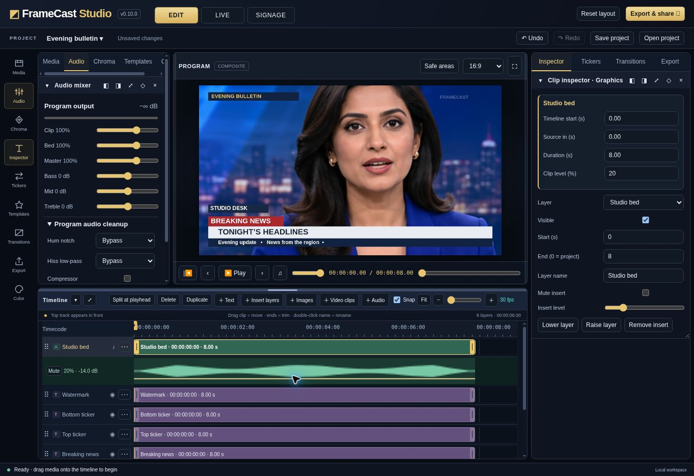

# FrameCast Studio v0.10.0

A local-first video graphics editor with a multitrack timeline and local Live/Signage workspaces. Development checkpoint; read [BUILD-STATUS.md](BUILD-STATUS.md) for tested behaviour and remaining work.



## Windows / your existing VS Code terminal

Stop the old server with **Ctrl+C**, then run these in the same terminal:

```powershell
Set-Location D:\Framecaststudio
git status --short
git fetch origin
git switch workbench/v0.10.0
py server.py
```

Open **http://localhost:4173**. Use **Ctrl+F5** to refresh old assets. The header must say **v0.10.0**. Do not open another VS Code window.

The version branch preserves the original main/baseline. If Git reports local edits would be overwritten, preserve those edits before switching; do not run a hard reset. The ZIP contains the same source without credentials or personal media.

Python 3.10+ runs the local server without pip dependencies. FFmpeg on PATH enables MP4/MOV/WebM conversion; without it, browser-supported recording remains available. Node 20+ is needed only for static build/tests.

## ZIP alternative

If you use the release ZIP instead of Git, preserve the current folder first:

```powershell
Set-Location D:\Framecaststudio
$backup = "D:\Framecaststudio-backup-$(Get-Date -Format yyyyMMdd-HHmmss)"
Copy-Item -LiteralPath D:\Framecaststudio -Destination $backup -Recurse
Expand-Archive -LiteralPath "$env:USERPROFILE\Downloads\FrameCast-Studio-v0.10.0.zip" -DestinationPath D:\Framecaststudio -Force
py server.py
```

This does not delete `.git` history or local `publish-settings.json`. Existing extra files remain. Use either Git or ZIP for the update, not both.

## Editing controls

- Drop media onto a timeline lane. Drag a clip body left/right for timing and up/down for layering. Top visible tracks render in front.
- Drag either end to trim; use the header grip to reorder without changing timing. Double-click the track name to rename. Right-click for insert/delete/layer actions.
- Select a video/audio layer to reveal its audio lane. Drag the volume line; double-click to add automation points. Right-click a point to remove it.
- Select the incoming clip, open **Transitions**, choose a preset and **Apply to selected**. Or drag the preset onto the clip. Adjust duration in seconds.
- Click a monitor object for resize handles. Images support Fit/Fill/Center, opacity, rotation, flip, fades, slides and zoom.
- **Ctrl+Z / Ctrl+Shift+Z** undo/redo; **S** splits; **Delete** removes a layer; **Space** toggles playback outside text inputs; **Ctrl+S** saves a project.
- Tools dock left/right, float by dragging their header, collapse, pin and resize. **Reset layout** restores workspace proportions.

Save a project before closing or refreshing. Session undo and a saved panel layout are not an automatic media/project backup.

## Export and publishing

Use **Export & share**, choose destinations, framing, format and resolution, then render. Rendering is real time; keep the tab visible. A shared aspect ratio is rendered once for selected destinations. Browser MP4 codecs vary; use local FFmpeg for H.264/AAC.

Connected publishing needs your configured Google/Meta developer apps and eligible accounts. See [PUBLISHING.md](PUBLISHING.md). Keep secrets in local configuration, never public `dist` files or browser JavaScript. Live streaming and rendered-video publishing are separate workflows.

## Build and verify

```powershell
npm test
py -m unittest discover -s tests -p "test_*.py" -v
npm run build
```

There are no npm dependencies to install. `dist/` includes only public assets. `vercel.json` builds this directory. Static Vercel hosting does not supply the local FFmpeg/OAuth backend; hosted backend work remains in the status report.
